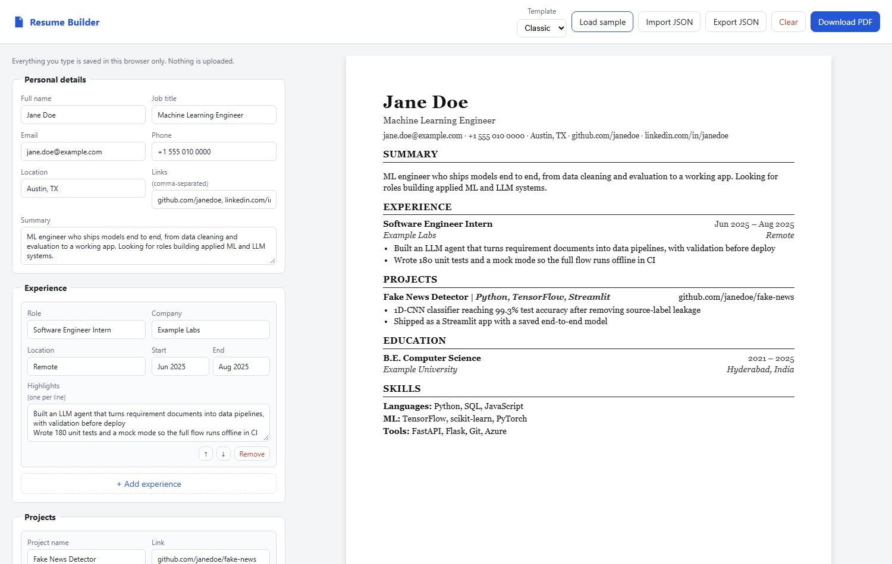
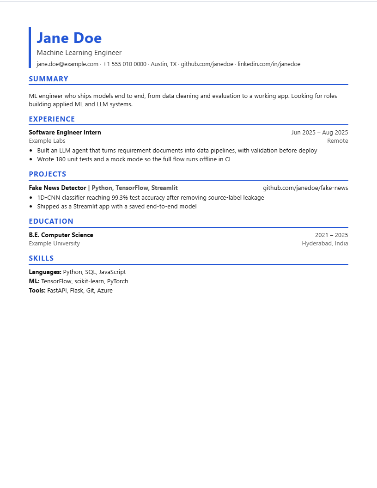

# Resume Builder

A fast, private resume builder that runs entirely in the browser. Fill in the form, watch an
ATS-friendly resume update live, and download it as a PDF. No sign-up, no server: your data
never leaves your machine.

**Live demo:** https://karnasanjana.github.io/Resume-Builder/



## Features

- **Live preview** of a print-ready US Letter page that updates as you type.
- **ATS-friendly output**: single column, real text (not an image), standard section headings.
- **Two templates**: a serif *Classic* and an accent-coloured *Modern*, switchable at any time.
- **Autosave** to `localStorage`, so a refresh never loses your work.
- **JSON export / import**: keep your resume as a portable data file, or move it between devices.
- **Download PDF** through the browser's print dialog, with print styles that hide the editor.
- **Repeatable sections** for experience, projects and education, with add, remove and reorder.
- **Safe rendering**: all user input is HTML-escaped before it's shown in the preview.
- **Zero dependencies**: vanilla HTML, CSS and JavaScript, about 300 lines of JS.



## Run locally

No build step. Open `index.html` in a browser, or serve the folder:

```bash
python -m http.server 8000      # then open http://localhost:8000
```

## How it works

```
form input ──► readState() ──► render(state) ──► #resume preview
                    │
                    └────────► localStorage (autosave)      Export / Import ⇄ JSON file
```

The whole resume is one plain JavaScript object (see `SAMPLE` in
[`assets/js/app.js`](assets/js/app.js)). The form, the preview, autosave and JSON
export are all driven from that single object, so they can never disagree.

## Project structure

```
├── index.html            # editor form, preview container, item templates
├── assets/css/styles.css # editor UI, both resume templates, print styles
├── assets/js/app.js      # state, rendering, autosave, import/export
└── docs/                 # screenshots
```

## Deploying

The site is static. On GitHub go to **Settings → Pages → Build and deployment**, choose
**Deploy from a branch**, then select `main` and `/ (root)`.
